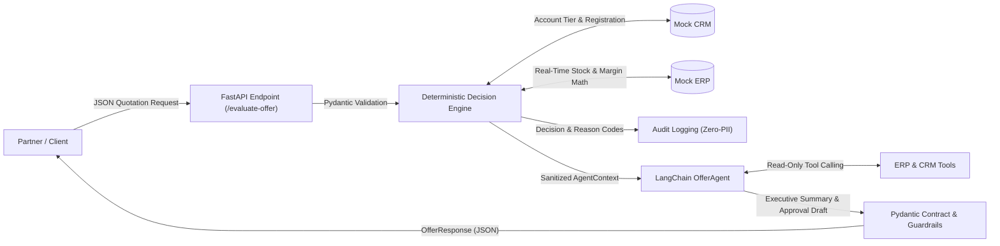

# AI-Powered B2B Quotation Pre-Evaluation Agent API

[](https://www.python.org/downloads/)
[](https://fastapi.tiangolo.com)
[](https://www.langchain.com/)
[](https://docs.pydantic.dev/)
[](https://opensource.org/licenses/MIT)

> **Enterprise Case Study Prototype:** An end-to-end, privacy-preserving AI decision support service designed for high-volume B2B technology distribution. It combines deterministic business rule engines, zero-PII data privacy guardrails, ERP/CRM tool calling, and resilient LLM deal summarization.

---

## Architectural Deliverables Index

| # | Deliverable | Associated File / Directory | Description |
|---|---|---|---|
| **1** | **Source Code** | [`app/`](app/), [`tests/`](tests/) | FastAPI application, deterministic `DecisionEngine`, PII scrubbers, and LangChain `OfferAgent`. |
| **2** | **Setup & Architecture Guide** | This document ([`README.md`](README.md)) | Quick start, system diagrams, design decisions, and automated test specifications. |
| **3** | **Mock Services & Data Sets** | [`MOCK_SERVICES.md`](MOCK_SERVICES.md) | Schemas for `data/` files, Service & Adapter pattern, and HTTP 502 gateway error handling. |
| **4** | **Sample cURL Requests & Responses** | [`CURL_SAMPLES.md`](CURL_SAMPLES.md) | End-to-end test cases across all decision branches in Mock and live Groq LLM modes. |
| **5** | **Privacy-Preserving Audit Logs** | [`AUDIT_LOGS.md`](AUDIT_LOGS.md) | `logs/audit.log` architecture, Zero-PII compliance, and UUID transaction traceability. |
| **6** | **AI Evaluation Report** | [`AI_EVALUATION_NOTE.md`](AI_EVALUATION_NOTE.md) | AI role positioning, tool-calling scope, 4-tier guardrails, and compliance principles. |

---

## Quick Start (Run Locally in 30 Seconds)

```bash
# 1. Install dependencies (Python 3.10+)
pip install -r requirements.txt

# 2. Launch the application in default Mock mode (no external API keys required)
uvicorn app.main:app --reload --port 8000
```

- **Interactive API Documentation (Swagger UI):** `http://localhost:8000/docs`
- **Health Check Endpoint:** `http://localhost:8000/`
- **Request Pipeline:** `HTTP Request` → `Pydantic 422 Validation` → `Deterministic Rule Engine` → `LangChain Tool Calling` → `4-Layer Guardrails` → `Structured JSON Response`.

---

## 1. System Architecture & Core Principles

The platform positions Artificial Intelligence not as an opaque decision-maker, but as a **deterministic decision-support copilot** that synthesizes business rule outputs, correlates ERP/CRM data via tool calling, and accelerates managerial review workflows:



### Core Architecture Pillars:
1. **Deterministic Decision Making:** The final verdict (`APPROVE`, `REJECT`, `NEED_APPROVAL`) is produced strictly by the rule-based `DecisionEngine`. The AI model can never alter or override business policy.
2. **Data Minimization (Zero-PII):** Customer personal identities (names, emails, phones) are stripped before context reaches external LLMs and are completely excluded from audit logs. The AI layer receives only a minimal, sanitized `AgentContext`.
3. **High Availability & Fault Resilience:** In the event of external LLM latency, rate-limiting (HTTP 429), or service outages, the system seamlessly activates a deterministic fallback summary (`_fallback_summary`), maintaining 100% service uptime.
4. **Dual Operating Modes:** Works out of the box in offline **Mock Mode** using deterministic tool execution; automatically switches to autonomous LLM tool calling when a **Groq API Key** is configured.

---

## 2. Design Decisions & Enterprise Assumptions

1. **What-If Deal Simulation Approach:**  
   Sales representatives frequently test various discount and quantity scenarios before locking a deal into the CRM. Consequently, `quantity`, `requested_discount`, and `product_id` are supplied dynamically in the request body, while the CRM backend verifies account credit tiers and deal registration legitimacy.
2. **Idempotent Evaluation (Side-Effect Free):**  
   The `/evaluate-offer` endpoint is purely read-only and idempotent. Querying an unregistered deal will not pollute enterprise databases with draft records, preventing data corruption.
3. **Synchronous Worker Thread Model:**  
   FastAPI endpoints are deliberately declared with `def` rather than `async def`. Because local JSON file reads and LangChain invocation chains are synchronous, running them inside FastAPI's internal AnyIO worker threadpool prevents blocking the main event loop.
4. **Partial Inventory Threshold (70% Rule):**  
   If available stock covers at least 70% of the requested order volume (`Coverage >= 70%`), the offer is not rejected outright; it is escalated to `NEED_APPROVAL` (`SLIGHTLY_LOW_STOCK`) to allow supply chain coordination. Orders covering less than 70% are automatically rejected (`INSUFFICIENT_STOCK`).

---

## 3. Directory Layout

```
project/ 
  app/ 
    main.py                 # FastAPI application root & health check
    config.py               # Pydantic BaseSettings environment configuration
    api/ 
      routes.py             # /evaluate-offer endpoint & orchestration pipeline
      schemas.py            # Pydantic v2 request/response validation contracts
    core/ 
      decision_engine.py     # Deterministic business rules & decision resolution
      pii.py                 # PII masking utilities (names, emails, phone numbers)
    services/ 
      crm_client.py          # CRM adapter (deal registration & partner tiers)
      erp_client.py          # ERP adapter (inventory lookup & net profit margin math)
    ai/ 
      offer_agent.py         # LangChain agent, tool calling & resilient fallback
      prompts.py             # System prompt template & reason code dictionary
    utils/ 
      logger.py              # Zero-PII JSON audit logging (console + file)
  data/ 
    offers.json             # Mock CRM quotation database
    stock.json              # Mock ERP warehouse inventory records
    prices.json             # Mock ERP base pricing & procurement cost records
  logs/ 
    audit.log               # Persistent JSON audit logs (Zero-PII compliant)
  tests/ 
    test_decision_engine.py # 28 automated unit, integration, and guardrail tests
  AI_EVALUATION_NOTE.md     # [Deliverable 6] AI architecture, scope & guardrails
  CURL_SAMPLES.md           # [Deliverable 4] Complete cURL commands & JSON responses
  MOCK_SERVICES.md          # [Deliverable 3] Service pattern & mock schemas
  AUDIT_LOGS.md             # [Deliverable 5] Zero-PII audit trail specifications
  README.md                 # [Deliverable 2] System architectural overview
  requirements.txt          # Python dependencies
```

---

## 4. Configuration & Execution Modes

### A. Default Local Mock Mode (Zero External Dependencies)
```bash
pip install -r requirements.txt
uvicorn app.main:app --reload --port 8000
```
- API Endpoint: `http://localhost:8000`
- Swagger UI Documentation: `http://localhost:8000/docs`

### B. Live Groq LLM Mode (LLaMA-3.3-70B / Qwen)
Configure `.env`:
```bash
LLM_MODE=groq
GROQ_API_KEY=gsk_your_groq_api_key_here
LLM_MODEL=llama-3.3-70b-versatile  # or qwen/qwen3.8-27b
```
Restart server: `uvicorn app.main:app --reload --port 8000`

---

## 5. Decision Engine Business Rules Matrix

The rule engine evaluates incoming quotations against ERP and CRM data, resolving the verdict through severity ranking (**`REJECT` > `NEED_APPROVAL` > `APPROVE`**):

| Rule Scenario | Policy Condition | Verdict | Reason Code |
|---|---|---|---|
| **Out of Stock** | Physical inventory <= 0 | `REJECT` | `OUT_OF_STOCK` |
| **Critical Stock Deficit** | Inventory < Demand and Coverage < 70% | `REJECT` | `INSUFFICIENT_STOCK` |
| **Slightly Low Stock** | Inventory < Demand and Coverage >= 70% | `NEED_APPROVAL` | `SLIGHTLY_LOW_STOCK` |
| **Critical Low Margin** | Calculated Net Margin < 10.0% | `NEED_APPROVAL` | `LOW_MARGIN` |
| **High Value Quotation** | Total Offer Amount > $100,000 | `NEED_APPROVAL` | `HIGH_VALUE_OFFER` |
| **Strategic Partner High Discount** | Tier = `strategic_partner` and Discount > 15.0% | `NEED_APPROVAL` | `STRATEGIC_HIGH_DISCOUNT` |
| **Customer Segment Mismatch** | Request tier != CRM registered master tier | `NEED_APPROVAL` | `SEGMENT_MISMATCH` |
| **Unregistered Offer** | Offer ID does not exist in CRM database | `NEED_APPROVAL` | `UNKNOWN_CUSTOMER` |
| **Invalid Product SKU** | Product ID does not exist in ERP catalog | `REJECT` | `PRODUCT_NOT_FOUND` |
| **All Criteria Met** | Inventory, margin, deal value, and data integrity confirmed | `APPROVE` | `ALL_CRITERIA_MET` |

*For mathematical margin formulas and service adapter details, see: [`MOCK_SERVICES.md`](MOCK_SERVICES.md)*

---

## 6. LangChain Tool Calling & 4-Tier Guardrail Architecture

### 4-Layer Guardrail Defense Line

To mathematically guarantee that AI outputs cannot manipulate or override deterministic business decisions, a 4-tier defense architecture is implemented:

1. **Architectural Pipeline Isolation (Single Source of Truth):**  
   The final verdict (`APPROVE`, `REJECT`, `NEED_APPROVAL`) and `reason_codes` are produced **before** invoking the AI layer. In [`app/api/routes.py`](app/api/routes.py), the API response binds directly to `decision=decision_result["decision"]`.
2. **Pydantic Contract Enforcement:**  
   Agent responses are strictly validated by [`AISummaryOutput`](app/ai/offer_agent.py):
   ```python
   class AISummaryOutput(BaseModel):
       ai_summary: str
       approval_message_draft: Optional[str] = None
   ```
   Because `decision` and `reason_codes` fields do not exist in the schema, the model is structurally incapable of tampering with decision data.
3. **Logic Guardrail (Draft Scrubbing):**  
   Approval request drafts are only permissible for `NEED_APPROVAL` verdicts. If an LLM hallucinates an approval draft for an approved or rejected offer, the application immediately nullifies it:
   ```python
   if decision != "NEED_APPROVAL":
       result["approval_message_draft"] = None
   ```
4. **Resilience & Fault Fallback:**  
   In the event of API timeouts, token limits (429), or invalid JSON, the application never raises an HTTP 500. Instead, `_fallback_summary` provides a deterministic rule-based summary (`ai_source: fallback`).

> **Automated Verification:** This defense line is tested on every CI execution via `test_guardrail_ai_cannot_override_decision` in [`tests/test_decision_engine.py`](tests/test_decision_engine.py).

---

## 7. Data Privacy & Zero-PII Compliance

To ensure complete compliance with GDPR, CCPA, and enterprise confidentiality requirements:

1. **Context Data Minimization:** Customer names, emails, and phone numbers are **never passed** to the LLM agent context (`AgentContext`) or audit log payloads.
2. **Tool Masking:** When the CRM tool is called, customer account identities are scrubbed via `pii.mask_name` (e.g., `Acme Technology` -> `A*** T*********`).
3. **Isolated Audit Logs:** `project/logs/audit.log` stores only correlation UUIDs (`request_id`), timestamps, and technical evaluation metrics.

*See [`AI_EVALUATION_NOTE.md`](AI_EVALUATION_NOTE.md) and [`AUDIT_LOGS.md`](AUDIT_LOGS.md) for full compliance breakdowns.*

---

## 8. Sample cURL Request & Response

Testing a deal that requires managerial review (low margin + high value):

```bash
curl -X POST "http://localhost:8000/evaluate-offer" \
  -H "Content-Type: application/json" \
  -d '{
    "offer_id": "OFF-10023",
    "customer": {"name": "Acme Technology", "email": "buyer@example.com"},
    "product_id": "PRD-445",
    "quantity": 8,
    "requested_discount": 12,
    "offer_total": 125000,
    "customer_segment": "strategic_partner"
  }'
```

**Response (HTTP 200 OK):**
```json
{
  "request_id": "0fba2488-ed3f-4106-8a26-2644b1a584c9",
  "offer_id": "OFF-10023",
  "decision": "NEED_APPROVAL",
  "reason_codes": [
    "LOW_MARGIN",
    "HIGH_VALUE_OFFER"
  ],
  "ai_summary": "For offer OFF-10023, partner segment 'strategic_partner' was verified via CRM. ERP records indicate available stock of 50 units with a projected net margin of 9.09%. Managerial approval is required due to triggered policy rules (LOW_MARGIN, HIGH_VALUE_OFFER).",
  "approval_required": true,
  "approval_message_draft": "Offer OFF-10023 for A*** T********* submitted for manager review due to: LOW_MARGIN, HIGH_VALUE_OFFER.",
  "pii_masked": true
}
```

*For complete test scenarios (APPROVE, REJECT, HTTP 422), see: **[`CURL_SAMPLES.md`](CURL_SAMPLES.md)***

---

## 9. Automated Test Suite

The test suite provides comprehensive coverage for all business rules, edge cases, and security guardrails:
- PII masking functions (`mask_name`, `mask_email`, `mask_phone`, `mask_offer_data`)
- Deterministic Decision Engine logic (10 distinct policy scenarios)
- **Guardrail Verification:** Guaranteeing that rogue AI responses cannot override engine verdicts
- Draft message nullification on APPROVE and REJECT verdicts
- Tool calling execution and fallback error resilience in Mock mode
- FastAPI integration and Pydantic HTTP 422 boundary validations

### Executing the Test Suite:
```bash
python -m unittest tests/test_decision_engine.py
```

**Output:**
```
Ran 28 tests in 0.032s

OK
```
