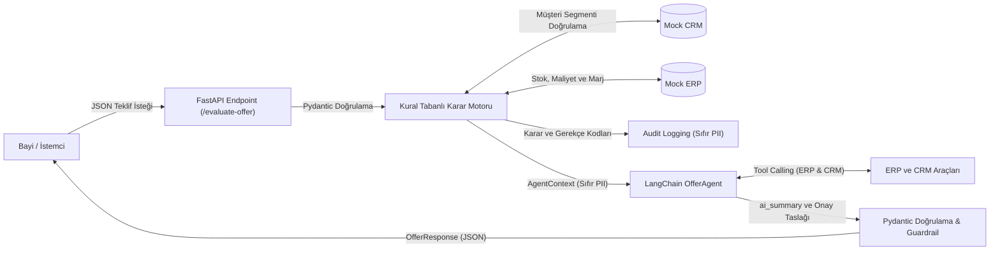

# Penta Teknoloji — Yapay Zekâ Destekli Teklif Ön Değerlendirme Agent API

> **Teslimat Kapsamı Notu:** Bu dokümantasyon; şartnamede (Bölüm 2) talep edilen çıktıları derli toplu sunan ana mimari rapordur. Şartnamede bağımsız incelenmesi beklenen modüler çıktılar repo kök dizinindeki ilgili dosyalara ayrıştırılmış olup aşağıdaki indekste özetlenmiştir.

---

## Teslimat Çıktıları İndeksi

| # | Şartname Çıktı Tanımı | Karşılık Gelen Dosya / Dizin | Açıklama |
|---|---|---|---|
| **1** | **Kaynak Kodlar** | [`app/`](app/), [`tests/`](tests/) | FastAPI API, DecisionEngine kural motoru, PII koruma ve LangChain ajanı. |
| **2** | **Kurulum ve Çalıştırma Kılavuzu** | Bu dosya ([`README.md`](README.md)) | Hızlı başlangıç, mimari diyagramlar, tasarım kararları ve test adımları. |
| **3** | **Mock Veri & Servis Yaklaşımı** | [`MOCK_SERVICES.md`](MOCK_SERVICES.md) | `data/` dosyalarının şemaları, Service/Adapter deseni ve 502 hata yönetimi. |
| **4** | **Örnek cURL İstekleri ve Yanıtlar** | [`CURL_SAMPLES.md`](CURL_SAMPLES.md) | 4 uç senaryonun cURL komutları, Mock ve canlı Groq LLM yanıtları. |
| **5** | **Kişisel Veri İçermeyen Audit Logları** | [`AUDIT_LOGS.md`](AUDIT_LOGS.md) | `logs/audit.log` mimarisi, sıfır PII prensibi ve izlenebilirlik kayıtları. |
| **6** | **AI Değerlendirme Notu** | [`AI_EVALUATION_NOTE.md`](AI_EVALUATION_NOTE.md) | Yapay zekâ kullanım amacı, sınırları, guardrail ve KVKK yaklaşımı. |

---

## Hızlı Başlangıç (Quick Start)

Sistemi 30 saniye içinde yerel ortamda çalıştırmak için:

```bash
# 1. Bağımlılıkları yükleyin (Python 3.10+)
pip install -r requirements.txt

# 2. Uygulamayı varsayılan Mock modunda başlatın (Harici API anahtarı gerekmez)
uvicorn app.main:app --reload --port 8000
```

- **İnteraktif Test Arayüzü (Swagger UI):** `http://localhost:8000/docs`
- **Sağlık Denetimi (Health Check):** `http://localhost:8000/`
- **Uçtan Uca Akış:** `HTTP İstek` → `Pydantic 422 Doğrulama` → `Deterministik Kural Motoru` → `LangChain Tool Calling` → `Guardrail` → `JSON Yanıt`.

---

## 1. Proje Mimarisi ve Temel Tasarım İlkeleri

Sistem, yapay zekâyı kritik iş kararlarını veren bir kara kutu olarak değil, **deterministik iş kurallarının çıktısını özetleyen ve yönetici onay süreçlerini hızlandıran bir karar destek asistanı** olarak konumlandırır:



### Temel Mimari Prensipler:
1. **Deterministik Karar Verme:** Nihai karar (`APPROVE`, `REJECT`, `NEED_APPROVAL`) kural tabanlı `DecisionEngine` tarafından verilir. Yapay zekâ iş kurallarının kararını asla değiştiremez veya geçersiz kılamaz.
2. **Veri Minimizasyonu (Sıfır PII):** Müşteri adı, e-posta ve telefon gibi kişisel veriler dış LLM sağlayıcısına iletilmez; denetim loglarına ise hiç dahil edilmez. Ajan katmanına yalnızca operasyonel `AgentContext` nesnesi aktarılır.
3. **Kesintisiz Hizmet ve Hata Toleransı:** Harici LLM servisinde gecikme, hız sınırı (429) veya bağlantı kopması yaşansa dahi sistem kural tabanlı deterministik yedek özetiyle (`_fallback_summary`) kesintisiz çalışmaya devam eder.
4. **Çift Modlu Çalışma Desteği:** Sistem harici API anahtarına ihtiyaç duymadan yerel Mock modunda çalışabildiği gibi, Groq API anahtarı tanımlandığında canlı araç çağıran LLM moduna geçer.

---

## 2. Tasarım Kararları ve Mimari Varsayımlar

1. **What-If (Taslak Teklif Simülasyonu) Yaklaşımı:**  
   Teklif değerlendirme isteklerinin satış temsilcisi tarafından CRM portalı üzerinden yapıldığı varsayılmıştır. Satış temsilcisi teklifi CRM'e kesin kaydetmeden önce ekranda farklı adet ve iskonto kombinasyonlarını simüle edebilir. Bu nedenle `quantity`, `requested_discount`, `product_id` alanları request body üzerinden dinamik olarak alınır; CRM'deki kayıt ise bayi segmenti ve müşteri geçmişi doğrulaması için kullanılır.
2. **Ön Değerlendirmenin Yan Etkisiz (Idempotent) Olması:**  
   `/evaluate-offer` servisi veritabanına kayıt yazmaz. CRM'de kaydı bulunmayan bir teklif sorgulandığında CRM veritabanına otomatik kayıt açılmaz; böylece taslak sorgularla kurumsal veritabanının kirlenmesi ve mükerrer kayıt riski önlenir.
3. **Senkron Çalışma Modeli:**  
   FastAPI uç noktası kasıtlı olarak `def` (senkron worker thread) tanımlanmıştır. Yerel JSON dosya okuma ve LangChain zinciri senkron çalıştığı için, FastAPI'nin bu çağrıları dahili anyio worker threadpool'unda koşturması ana asenkron event loop'un kilitlenmesini engeller.
4. **Kısmi Stok ve Tedarik Eşiği (%70 Oranı):**  
   Talep edilen ürünün %70 veya daha fazlası depoda mevcutsa (`Karşılama >= %70`), satış fırsatını kaçırmamak adına teklif doğrudan reddedilmez; tedarik zinciriyle koordinasyon sağlanması amacıyla `NEED_APPROVAL` (`SLIGHTLY_LOW_STOCK`) statüsüne alınır. %70'in altı doğrudan `REJECT` (`INSUFFICIENT_STOCK`) kabul edilir.

---

## 3. Klasör Yapısı

```
project/ 
  app/ 
    main.py                 # FastAPI ana uygulaması ve health-check
    config.py               # Pydantic BaseSettings yapılandırması (.env)
    api/ 
      routes.py             # /evaluate-offer uç noktası ve orkestrasyon
      schemas.py            # Pydantic istek/yanıt şemaları (gt=0, ge=0.0 sınırları)
    core/ 
      decision_engine.py     # Deterministik iş kuralları ve karar motoru
      pii.py                 # KVKK/PII maskeleme fonksiyonları
    services/ 
      crm_client.py          # Mock CRM istemcisi (teklif ve segment doğrulama)
      erp_client.py          # Mock ERP istemcisi (stok, maliyet, fiyat, dinamik marj)
    ai/ 
      offer_agent.py         # LangChain Agent, Tool Calling & Fallback yönetimi
      prompts.py             # Sistem promptları ve gerekçe kodu sözlüğü
    utils/ 
      logger.py              # PII-güvenli JSON audit logging (StreamHandler + FileHandler)
  data/ 
    offers.json             # Örnek teklif veri kümesi (farklı senaryolar)
    stock.json              # Depo ve ürün stok verileri
    prices.json             # Ürün maliyet ve taban fiyat verileri
  logs/ 
    audit.log               # Kişisel veri içermeyen JSON denetim kayıtları
  tests/ 
    test_decision_engine.py # 28 adet otomatik birim ve entegrasyon testi
  AI_EVALUATION_NOTE.md     # [Çıktı 6] Yapay zekâ değerlendirme notu
  CURL_SAMPLES.md           # [Çıktı 4] Örnek cURL istekleri ve yanıtlar
  MOCK_SERVICES.md          # [Çıktı 3] Mock veri ve servis deseni açıklaması
  AUDIT_LOGS.md             # [Çıktı 5] Kişisel veri içermeyen audit log kılavuzu
  README.md                 # [Çıktı 2] Ana mimari dokümantasyon
  requirements.txt          # Python bağımlılıkları
```

---

## 4. Kurulum ve Çalıştırma

### A. Varsayılan (Mock) Modda Çalıştırma (Harici API Anahtarı Gerekmez):
```bash
# Proje dizininde sanal ortam kurup başlatın
pip install -r requirements.txt
uvicorn app.main:app --reload --port 8000
```
- API Temel Adresi: `http://localhost:8000`
- Swagger UI (İnteraktif Test Arayüzü): `http://localhost:8000/docs`

### B. Canlı Groq LLM Modunda Çalıştırma:
`.env` dosyasını düzenleyin:
```bash
LLM_MODE=groq
GROQ_API_KEY=gsk_your_groq_api_key_here
LLM_MODEL=llama-3.3-70b-versatile  # veya qwen/qwen3.8-27b
```
Sunucuyu yeniden başlatın: `uvicorn app.main:app --reload --port 8000`

---

## 5. Karar Mekanizması ve İş Kuralları

Karar motoru, gelen teklif verisini CRM ve ERP sistemleriyle çapraz kontrol ederek deterministik olarak değerlendirir:

> **Not (Örnek Varsayımlar):** Aşağıdaki eşik değerleri (marj <%10, tutar >100.000 TL, stratejik indirim >%15, stok karşılama oranı %70), case study senaryolarını test edebilmek amacıyla kurgulanmış örnek iş kuralı varsayımlarıdır. Üretim ortamında bu parametreler `.env` veya veritabanı üzerinden dinamik olarak yapılandırılabilir.

| Durum / Kural | Koşul | Üretilen Karar | Gerekçe Kodu |
|---|---|---|---|
| **Stok Yok** | Depo stoğu <= 0 | `REJECT` | `OUT_OF_STOCK` |
| **Kritik Stok Yetersizliği** | Stok < Talep ve Karşılama Oranı < %70 | `REJECT` | `INSUFFICIENT_STOCK` |
| **Kısmi Stok (Tedarik Edilebilir)** | Stok < Talep ve Karşılama Oranı >= %70 | `NEED_APPROVAL` | `SLIGHTLY_LOW_STOCK` |
| **Kritik Düşük Marj** | Net Marj < %10.0 | `NEED_APPROVAL` | `LOW_MARGIN` |
| **Yüksek Tutarlı Teklif** | Toplam Tutar > 100.000 TL | `NEED_APPROVAL` | `HIGH_VALUE_OFFER` |
| **Stratejik Bayi Yüksek İndirim** | Segment = `strategic_partner` ve İndirim > %15.0 | `NEED_APPROVAL` | `STRATEGIC_HIGH_DISCOUNT` |
| **Segment Uyuşmazlığı** | İstekteki segment != CRM kayıtlı segmenti | `NEED_APPROVAL` | `SEGMENT_MISMATCH` |
| **Bilinmeyen Müşteri / Teklif** | Teklif ID CRM'de kayıtlı değil | `NEED_APPROVAL` | `UNKNOWN_CUSTOMER` |
| **Tanımsız Ürün** | Ürün ID ERP'de mevcut değil | `REJECT` | `PRODUCT_NOT_FOUND` |
| **Tüm Kriterler Uygun** | Stok, marj, tutar ve veri bütünlüğü onaylı | `APPROVE` | `ALL_CRITERIA_MET` |

*Net kâr marjı hesabı ve mock veri yapıları için bknz: [`MOCK_SERVICES.md`](MOCK_SERVICES.md)*

---

## 6. LangChain / Agent Yaklaşımı ve Guardrail Mimarisi

Şartnamede (Bölüm 2) tanımlanan teknik beklentilerin mimarideki karşılıkları ve kod eşleştirmeleri:

| Minimum Beklentiler | Ek Değer Sağlayan Yaklaşımlar | Projedeki Uygulama / Karşılık Gelen Kod Referansları |
|---|---|---|
| **Prompt template kullanımı** | Prompt içeriklerinde kişisel verilerin maskelenmesi ve veri minimizasyonu. | [`app/ai/prompts.py`](app/ai/prompts.py) & [`app/ai/offer_agent.py`](app/ai/offer_agent.py)<br>• Modüler `ChatPromptTemplate` yapısı.<br>• Prompt'a müşteri adı, e-posta aktarılmaz; izole `AgentContext` iletilir. |
| **Tool / function calling yaklaşımı** | ERP ve CRM fonksiyonlarının agent iş akışı içerisinde kontrollü kullanımı. | [`app/ai/offer_agent.py`](app/ai/offer_agent.py) (`@tool get_crm_offer_details`, `@tool get_erp_product_details`)<br>• Salt-okunur LangChain `@tool` fonksiyonları.<br>• CRM aracı müşteri adını maskeli (`A** T********`) döndürür. |
| **AI destekli özet üretimi** | Karar motoru çıktılarıyla tutarlı, bağlamsal ve açıklayıcı özetler. | [`app/ai/offer_agent.py`](app/ai/offer_agent.py) (`generate_summary`)<br>• Gerekçe kodlarını kurumsal özete dönüştürür.<br>• Yalnızca onay gereken durumlarda yönetici mesaj taslağı (`approval_message_draft`) üretir. |
| **Fallback mekanizması** | LLM kaynaklı hata durumlarında uygulamanın kontrollü çalışmaya devam etmesi. | [`app/ai/offer_agent.py`](app/ai/offer_agent.py) (`_fallback_summary`)<br>• Groq API kesintisi veya geçersiz çıktılarda sistem çökmez; kural tabanlı sistem özeti (`ai_source: fallback`) devreye girer. |
| **Çıktı kontrol mekanizmaları (Guardrails)** | Yapay zekânın iş kurallarıyla üretilen kararları değiştiremeyeceğinin garanti edilmesi. | [`app/api/routes.py`](app/api/routes.py) & [`tests/test_decision_engine.py`](tests/test_decision_engine.py)<br>• **Pipeline Isolation:** Karar API çıktısına doğrudan kural motorundan atanır.<br>• **Pydantic Contract:** `AISummaryOutput` şemasında karar alanı bulunmaz.<br>• **Logic Guardrail:** APPROVE ve REJECT kararlarında taslak mesaj kod seviyesinde `None` yapılarak sıfırlanır. |

### 4 Katmanlı Guardrail Savunma Hattı

Yapay zekânın deterministik iş kurallarını manipüle edememesi ve karar sınırlarını aşamaması için 4 aşamalı bir savunma hattı kurulmuştur:

1. **Mimari Karar İzolasyonu (Pipeline Isolation - Single Source of Truth):**  
   Nihai karar (`APPROVE`, `REJECT`, `NEED_APPROVAL`) ve gerekçe kodları (`reason_codes`), yapay zekâ ajanı çağrılmadan **önce** kural motoru tarafından üretilir. [`app/api/routes.py`](app/api/routes.py) içindeki `evaluate_offer` fonksiyonunda API çıktısı oluşturulurken `decision=decision_result["decision"]` atanır. Yapay zekâ modelinin çıktısı bu alana teknik olarak bağlanmamıştır.
2. **Sözleşme Düzeyinde Kontrol (Pydantic Contract Guardrail):**  
   Ajanın çıktısı [`AISummaryOutput`](app/ai/offer_agent.py) modeli ile doğrulanır:
   ```python
   class AISummaryOutput(BaseModel):
       ai_summary: str
       approval_message_draft: Optional[str] = None
   ```
   Bu modelde `decision` veya `reason_codes` alanı bulunmadığından model karar manipülasyonu yapabilecek bir veri üretemez.
3. **Mantıksal Güvenlik Duvarı (Logic Guardrail - Draft Nulling):**  
   Yapay zekâ halüsinasyon sonucu onaylanmış (`APPROVE`) veya reddedilmiş (`REJECT`) bir teklif için onay taslağı üretse dahi, Python kodu bunu anında ezerek sıfırlar:
   ```python
   # Guardrail: Yalnızca NEED_APPROVAL durumunda taslak mesaj üretilebilir
   if decision != "NEED_APPROVAL":
       result["approval_message_draft"] = None
   ```
4. **Kesintisiz Hizmet ve Hata Dayanıklılığı (Fallback):**  
   Groq API kesintisi, hız sınırı (429) veya geçersiz JSON çıktısı durumunda uygulama `HTTP 500` hatası vermez; `_fallback_summary` devreye girerek kural motorunun çıktılarını içeren deterministik bir sistem özeti döner (`ai_source: fallback`).

> **Otomatik Test Güvencesi:** Bu guardrail mekanizması [`tests/test_decision_engine.py`](tests/test_decision_engine.py) altındaki `test_guardrail_ai_cannot_override_decision` testi ile her çalıştırmada otomatik olarak doğrulanmaktadır.

### Çift Modlu Çalışma Ayrımı:
- **API Anahtarı Gerektirmeyen Mock Modu (`LLM_MODE=mock`):** LangChain Tool arayüzleri deterministik olarak doğrudan çağrılarak ajan veri akışı yerel olarak test edilir; harici internet bağımlılığı yoktur.
- **Canlı LLM Modu (`LLM_MODE=groq`):** LangChain'in `create_tool_calling_agent` mekanizması ile LLM otonom araç çağırma zincirini işletir.

---

## 7. Kişisel Verilerin Korunması ve Veri Minimizasyonu

Penta Teknoloji iş ortaklarının ticari ve kişisel verilerinin korunması amacıyla **Tasarımda Gizlilik** ve **Veri Minimizasyonu** ilkeleri benimsenmiştir:

1. **Veri Minimizasyonu (Data Minimization):** Müşteri kişisel verileri maskelenmeden de önce, mimari düzeyde dış LLM'e iletilen `AgentContext` nesnesine ve `audit.log` payload'ına **fiziksel olarak hiç dahil edilmez**.
2. **Araç Yanıtlarında Maskeleme:** Ajan CRM aracını (`get_crm_offer_details`) çağırdığında, CRM istemcisi müşteri adını `pii.mask_name` fonksiyonundan geçirerek maskeler (`A** T********`).
3. **Denetim İzolasyonu:** `project/logs/audit.log` dosyasında müşteri adı, e-posta veya telefon yer almaz; yalnızca `request_id`, `offer_id` ve teknik değerlendirme metrikleri saklanır.

*Yapay Zekâ ve Gizlilik yaklaşımının detayları için bknz: [`AI_EVALUATION_NOTE.md`](AI_EVALUATION_NOTE.md)*  
*Örnek log formatı ve izlenebilirlik kayıtları için bknz: [`AUDIT_LOGS.md`](AUDIT_LOGS.md)*

---

## 8. Hızlı Test: Örnek cURL Çağrısı

Onay gerektiren düşük marj ve yüksek tutarlı bir teklifin hızlı testi:

```bash
curl -X POST "http://localhost:8000/evaluate-offer" \
  -H "Content-Type: application/json" \
  -d '{
    "offer_id": "OFF-10023",
    "customer": {"name": "ABC Teknoloji", "email": "buyer@example.com"},
    "product_id": "PRD-445",
    "quantity": 8,
    "requested_discount": 12,
    "offer_total": 125000,
    "customer_segment": "strategic_partner"
  }'
```

**Dönen Yanıt (HTTP 200 OK):**
```json
{
  "request_id": "0fba2488-ed3f-4106-8a26-2644b1a584c9",
  "offer_id": "OFF-10023",
  "decision": "NEED_APPROVAL",
  "reason_codes": [
    "LOW_MARGIN",
    "HIGH_VALUE_OFFER"
  ],
  "ai_summary": "Stratejik partner A** T********'a ait 125.000 TL tutarındaki teklif, %12 indirimle net marjı %9,09'a düşürdüğü ve yüksek tutarlı olması nedeniyle onaya sevk edildi. Stok durumu (50 adet) uygun görünüyor.",
  "approval_required": true,
  "approval_message_draft": "Sayın Yöneticim, OFF-10023 numaralı teklif (müşteri: A** T********, segment: stratejik partner) %12 indirim talebiyle net marjı %9,09'a çekmekte olup 125.000 TL tutarıyla yüksek limit eşiğini aşmaktadır. Stok yeterlidir (50 adet). Stratejik ilişki gözetilerek onayınızı rica ederim.",
  "pii_masked": true
}
```

> **Tüm Senaryolar:** Normal teklif (APPROVE), yetersiz stok (REJECT) ve HTTP 422 doğrulama hatalarına ait detaylı cURL komutları ve Mock/Groq yanıtları için bakınız: **[`CURL_SAMPLES.md`](CURL_SAMPLES.md)**

---

## 9. Birim Testler

Test paketi, şartnamede yer alan tüm senaryoları ve guardrail mekanizmalarını otomatik doğrular:
- PII maskeleme fonksiyonları (`mask_name`, `mask_email`, `mask_phone`)
- Deterministik karar motoru iş kuralları (10 kural durumu)
- **Guardrail Güvencesi:** Yapay zekânın kural motoru kararını asla değiştiremeyeceğinin testi (`test_guardrail_ai_cannot_override_decision`)
- APPROVE / REJECT kararlarında onay taslağı sıfırlama (Draft nulling)
- Mock modda araç çağırma ve fallback dayanıklılık testleri
- FastAPI entegrasyonu ve Pydantic 422 sınır denetimleri

### Testleri Çalıştırma:
```bash
python -m unittest tests/test_decision_engine.py
```

**Test Çıktısı:**
```
Ran 28 tests in 0.028s

OK
```
